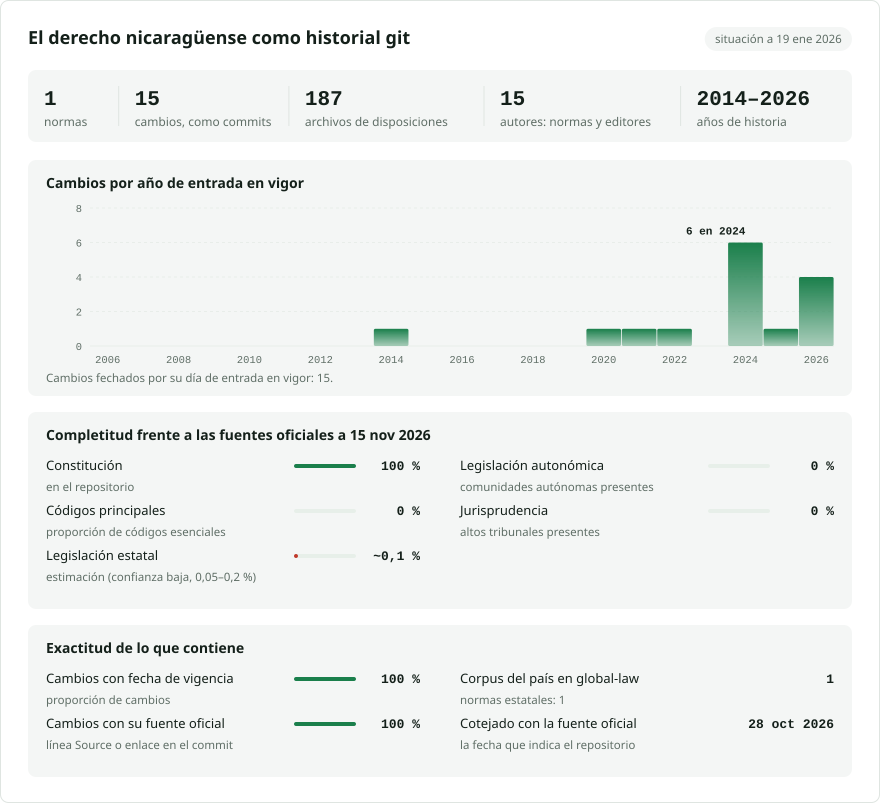

# Nicaragua: historia del derecho en git

**Español** · [English](README.en.md)

<picture>
<source media="(prefers-color-scheme: dark)" srcset="data/es/effort-dark.svg">

</picture>

El derecho de Nicaragua como historial de git: un archivo por artículo, un commit por versión, fechado el día de su entrada en vigencia, y la ley que hizo cada cambio como autora del commit. `git blame` nombra la ley de cada párrafo; `git log` enumera cada cambio de un artículo; al elegir una fecha se obtiene el texto vigente ese día.

Forma parte de [lexifina/global-law](https://github.com/lexifina/global-law), un único historial de git para el derecho de todos los países: este es el derecho nacional de Nicaragua, que global-law lee en `nicaragua/national/acts/`.

**Qué contiene ahora:** la Constitución Política de la República de Nicaragua, en 15 versiones, desde el texto oficial de 2014 hasta la Ley N° 1271 (vigente desde el 19 de enero de 2026): cuatro textos íntegros oficiales (2014, las consolidaciones del Digesto de 2022 y 2024 y el Texto Íntegro de 2025) y 11 leyes de reforma entre ellos. Todavía no hay ninguna otra norma. [`laws.csv`](laws.csv) enumera cada versión con su Gaceta y su día de entrada en vigencia, y [`SOURCES.md`](SOURCES.md) enlaza cada una con su página y su número de La Gaceta.

Cada artículo es un archivo en `constitucion/` (`constitucion/articulo-001.md` es el artículo 1); `preambulo.md`, `estructura.md` (títulos y capítulos) y `cierre.md` (la fórmula de cierre) contienen el resto. La Ley N° 1234 renumeró los artículos el 18 de febrero de 2025 (de 202 pasaron a 184): a partir de entonces, un archivo contiene el artículo de ese número en el nuevo texto, por lo que, a través de ese commit, hay que comparar textos, no rutas.

El texto está en español, tal como lo imprime Normas Jurídicas de Nicaragua, errores de digitación incluidos. Una traducción al inglés no forma parte de este registro.

## Preguntas como comandos de git

| Pregunta | Comando |
| --- | --- |
| Cada cambio del artículo 1 de la Constitución | `git log -p --word-diff -- constitucion/articulo-001.md` |
| ¿Qué ley escribió cada línea del artículo 1? | `git blame constitucion/articulo-001.md` |
| Cada versión de la Constitución, con el día en que entró en vigencia cada una | `git log --format="%h %(trailers:key=In-force,valueonly,separator=) %an" -- constitucion` |
| El artículo 1 vigente el 1 de enero de 2024 | `python tools/in_force_on.py 2024-01-01 constitucion 1` |

**Fuera de git**, también alojamos este registro de forma pública y gratuita:

- **[Pregunte a Claude sobre el derecho nicaragüense](https://global-law.lexifina.com/v1/try_claude?country=nicaragua)**: abre Claude con una primera pregunta ya preparada.
- **[Pregunte a ChatGPT](https://global-law.lexifina.com/v1/try_chatgpt?country=nicaragua)**: la misma pregunta en ChatGPT.
- **[Busque en el derecho nicaragüense en nuestro sitio](https://lexifina.com/law?country=nicaragua&q=vacaciones)**: una búsqueda de "vacaciones", con el texto de cada disposición y sus versiones, sin necesidad de cuenta.
- **[API REST para desarrolladores](https://global-law.lexifina.com/v1/search_law?query=vacaciones&jurisdiction=nicaragua)**: la misma búsqueda en JSON, sin clave. Consulte la [documentación aquí](https://lexifina.com/api/global-law).

Ambos asistentes leen el registro mediante el conector gratuito Global law (MCP, `https://global-law.lexifina.com/mcp`); la primera vez, el chat le da el enlace para añadirlo. Pregunte en español o en inglés.

**Alójelo usted mismo fácilmente.** Solo hacen falta git y Python, y las herramientas se ejecutan en su propio equipo:

```sh
git clone --depth 1 https://github.com/lexifina/global-law && cd global-law
python3 tools/countries.py add nicaragua/national/acts
python3 tools/law.py show 2026-01-01 nicaragua/national/acts/constitucion/articulo-001.md
```

Abierto en Claude Code, Cursor, VS Code o Codex, el clon también inicia un servidor MCP local con las mismas herramientas ([MCP.md](https://github.com/lexifina/global-law/blob/main/MCP.md)).

## Fechas

Cada commit está fechado al mediodía, hora de America/Managua (UTC-6), del día en que la versión entró en vigencia, y lo lleva en su trailer `In-force:`, junto a `Enacted:` (aprobación por la Asamblea Nacional) y `Published:` (el número de La Gaceta, Diario Oficial):

- cada ley de este registro entra en vigencia con su publicación en La Gaceta, como dice su último artículo, y el trailer `In-force-basis:` del commit cita esa cláusula; dos leyes que entran en vigencia el mismo día son dos commits con un segundo de diferencia, en el orden de sus números;
- las reformas de enero de 2024 (Leyes N° 1186, 1187, 1188 y 1190) todavía llevan la cláusula de su iniciativa en primera legislatura; se fechan por la publicación de las leyes promulgadas, que la consolidación de 2024 incorpora;
- el texto de 2014 está fechado el 10 de febrero de 2014, el día en que entró en vigencia la Ley N° 854, cuyas reformas incorpora: sus líneas deben leerse como vigentes ese día a más tardar.

Cada cambio se atribuye a la ley que lo hizo (`Ley N° 1057`); el texto de 2014, que contiene la Constitución de 1987 con todas sus reformas hasta la Ley N° 854, a su editor, y las consolidaciones del Digesto a las leyes que les dieron fuerza de ley (Leyes N° 1091 y 1196). Esas consolidaciones no cambian ninguna norma, pero sus commits llevan las correcciones del Digesto a errores de digitación y de puntuación. El committer es Lexifina.

## Cómo se comprueba

- `tools/check_repo.py` compara cada versión en git, byte a byte, con lo que dice la fuente: los cuatro textos oficiales con sus propias páginas, y la versión de cada ley de reforma con la anterior más las palabras que cita la ley (15 versiones, 2,985 archivos, 0 fallos).
- Cada texto oficial se compara de nuevo como letras y dígitos tomados directamente de su página, sin el analizador, y cada artículo que una ley de reforma sustituyó es idéntico, palabra por palabra, en el siguiente texto oficial. Las reformas de 2026 todavía no tienen un texto oficial posterior.
- `tools/test_repo.py` comprueba que funcionan blame, la herramienta por fecha y los comandos anteriores. Los resultados, el sha256 de cada página usada y los pasos para reconstruirlo con los mismos hashes están en [`REPRODUCE.md`](REPRODUCE.md).

## Lo que no muestra

- **Otras normas.** Solo está aquí la Constitución; Normas Jurídicas de Nicaragua enumeraba 27,028 documentos el 28 de octubre de 2026.
- **La Constitución anterior a 2014.** El original de 1987 y las reformas de 1990 a 2014 están aquí solo como el texto de 2014.
- **Los cambios que no tocan las palabras**, como el art. 3 de la Ley N° 1269 (léase "Procuraduría General de Justicia" donde la ley dice "Procuraduría General de la República") o las resoluciones de la Corte Suprema de Justicia.
- **Los textos en las lenguas de la Costa Caribe** (la base de datos contiene un texto en mayangna de 2012).

## Fuentes

| Fuente | Tipo | Versiones anteriores | Notas |
| --- | --- | --- | --- |
| [Normas Jurídicas de Nicaragua](http://legislacion.asamblea.gob.ni/Normaweb.nsf/) (Asamblea Nacional) | Base de datos oficial de legislación | sí, los textos íntegros de 2014, 2022, 2024 y 2025 y cada ley de reforma | Cada documento enlaza con el escaneo del número de La Gaceta que lo publicó |
| La Gaceta, Diario Oficial | Diario oficial, el texto auténtico | tal como se publicó | Dos números leídos a mano para confirmar una fecha y un párrafo |

## Licencia

Véase [`LICENSE`](LICENSE). Las leyes no están protegidas por el derecho de autor en Nicaragua (Ley N° 312, Ley de Derecho de Autor y Derechos Conexos, art. 16), y la base de datos no publica condiciones de uso. El historial, las tablas y las herramientas son CC0 1.0.

Ningún modelo de IA escribió texto jurídico ni se ejecutó al construir el historial; el código lo escribió Claude Code con Claude Opus 5.5, que también eligió el alcance y leyó las cláusulas de entrada en vigencia (véase [`REPRODUCE.md`](REPRODUCE.md)).

Esta es una traducción de la versión inglesa ([README.en.md](README.en.md)); si difieren, prevalece la versión inglesa.

## Más información

Del repositorio [lexifina/global-law](https://github.com/lexifina/global-law) (páginas en inglés):

- [FEATURES.md](https://github.com/lexifina/global-law/blob/main/FEATURES.md): todas las funciones y lo que cada corpus debe admitir (`git blame`, `law.py`, herramientas MCP)
- [FAQ.md](https://github.com/lexifina/global-law/blob/main/FAQ.md): preguntas y respuestas · [CONTRIBUTING.md](https://github.com/lexifina/global-law/blob/main/CONTRIBUTING.md): proponer cambios · [MCP.md](https://github.com/lexifina/global-law/blob/main/MCP.md): servidor MCP · [REPRODUCE.md](https://github.com/lexifina/global-law/blob/main/REPRODUCE.md): cómo se ha construido · [CHANGELOG.md](https://github.com/lexifina/global-law/blob/main/CHANGELOG.md)
- [FRESHNESS.md](https://github.com/lexifina/global-law/blob/main/FRESHNESS.md): lo actualizado que está cada corpus · [Supervisión](https://github.com/lexifina/global-law/tree/main/monitoring): si las actualizaciones funcionan · [WATCHING.md](https://github.com/lexifina/global-law/blob/main/WATCHING.md): cómo se vigila cada fuente oficial para detectar cambios
- [performance/](https://github.com/lexifina/global-law/tree/main/performance): la rapidez de las herramientas, medida
- [visualisations/](https://github.com/lexifina/global-law/tree/main/visualisations): gráficos y conexiones a través del derecho de todo el mundo
- [Vulnerabilidades](https://github.com/lexifina/global-law/tree/main/vulnerabilities): errores en las normas tal como se publicaron
